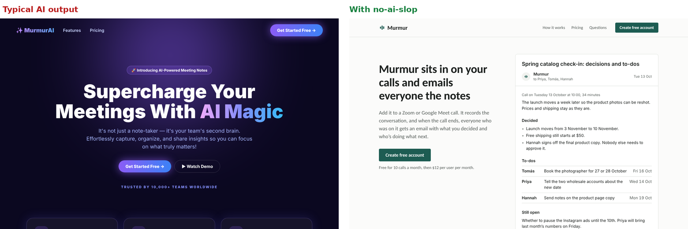
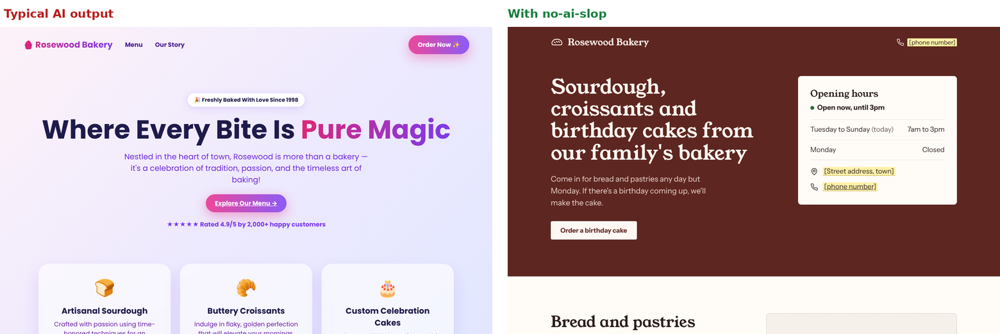

# no-ai-slop

A skill for Claude that stops websites from looking and sounding like AI made them.

You know the look. Purple gradient, glowing buttons, a ✨ in the logo, emoji for icons, "Supercharge your workflow" in giant letters, and "Trusted by 10,000+ teams" that nobody can check. This skill removes all of that, and the AI-sounding text along with it.

## What it looks like

**A startup landing page**



The left side is what AI tools usually produce for "make a landing page for my meeting notes app". The right side came from the same request with the skill turned on. It shows a real example of what the product sends you, says which apps it works with, and puts the price right under the button.

**A family bakery**



The left side invents a founding year, a 4.9 rating and "2,000+ happy customers". The right side only uses what the owner said (sourdough, croissants, birthday cakes, open Tuesday to Sunday 7am to 3pm). Everything it didn't know, like the address and phone number, is left as a yellow box to fill in.

The scanner that comes with the skill found 34 problems in each page on the left and none in the pages on the right.

## Live demos: Claude with and without the skill

The pictures above use a hand-made "typical AI" page on the left, to show the usual patterns. For a fair test, I also gave Claude the same two requests twice, once with the skill and once without, and kept every result as it came out.

**[Open the demos](https://tovaisme.github.io/no-ai-slop/demos/)** (the files are in [`demos/`](demos/))

Claude does fine on its own, so the differences are smaller than in the pictures above, but they're there:

- **Landing page.** Without the skill, it went for a cream background with a big serif headline, which is the look AI tools now fall back on when told to avoid purple. With the skill, the page is plainer and leads with a full example of the email the product sends.
- **Bakery.** Without the skill, it wrote things the owner never said ("made with our own starter", "a long, slow rise", croissants that "go quickly") and used six em dashes. With the skill, it only used the facts it was given and left yellow boxes for the rest.
- **Checks.** Across both tasks, plus a cleanup task, the runs with the skill passed 33 of 33 automatic checks and the runs without it passed 29 of 33. The skill takes about twice as long, because it keeps rechecking until nothing is left.

## The text matters as much as the design

| AI wrote | With the skill |
|---|---|
| Supercharge Your Meetings With AI Magic | Murmur sits in on your calls and emails everyone the notes |
| It's not just a note-taker, it's your team's second brain | Add it to a Zoom or Google Meet call. When the call ends, everyone gets the decisions and to-dos. |
| Nestled in the heart of town, Rosewood is more than a bakery | Sourdough, croissants and birthday cakes from our family's bakery |
| Get Started Free → | Create free account |
| Trusted by 10,000+ teams worldwide | (removed, since there was no real number) |
| Where Every Bite Is Pure Magic | Come in for bread and pastries any day but Monday |

## What it checks

- **Design:** gradients, glows, glassy cards, blurry blobs, emoji icons, ALL-CAPS labels, random spacing, everything rounded, hover bounces, charts with no axis
- **Words:** buzzwords like "unlock" and "seamless", "not just X, it's Y", "Fast. Simple. Powerful.", "Tired of...?" openers, em dashes, exclamation marks, Title Case headings
- **Honesty:** made-up stats, fake testimonials, star ratings, invented history. It uses placeholders instead and tells you what to fill in.

It goes through the whole project: every page, the 404 page, error messages, button labels, translation files and meta tags. It fixes things, checks again, and keeps going until a full round finds nothing.

It also won't swap one look for another. A bakery should feel like a bakery, not like a dark tech dashboard.

If you ask for a purple gradient, you get a purple gradient. It only removes defaults, not things you chose.

## Install

**Claude Code:** copy this folder into `~/.claude/skills/`:

```bash
git clone https://github.com/TovaIsME/no-ai-slop ~/.claude/skills/no-ai-slop
```

**Claude.ai:** go to Settings, then Capabilities, then Skills, and upload `SKILL.md`.

After that, ask Claude to build or clean up a site as usual. The skill turns on by itself. You can also ask for it directly: "unslop this site".

## Try it

Paste this into a new chat:

> Make a one-page website for my personal trainer business, Coach Layla. I do one-on-one training at clients' homes, plus small group classes in the park on Saturday mornings. A single session costs 25 OMR, a pack of 10 costs 220 OMR. People book on WhatsApp. One HTML file is fine.

## The scanner

`scripts/slop_scan.py` runs on its own, with no installs needed beyond Python:

```bash
python3 scripts/slop_scan.py path/to/your/site
```

It lists every problem with the file and line number, and ends with CLEAN or NOT CLEAN. Add `--check` to get exit code 1 while anything is left, which is handy in CI. If you really want something it flags, put `slop-ok: your reason` in a comment on that line.

The same scanner is also inside `SKILL.md`, so the skill works even if you only upload that one file.

## Files

```
SKILL.md                the skill (everything Claude needs is in here)
scripts/slop_scan.py    the scanner as a standalone file
images/                 the comparisons above
demos/                  real outputs, with and without the skill
```

## License

MIT
